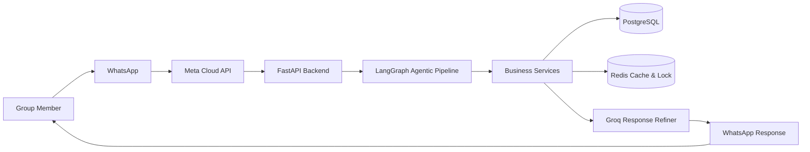
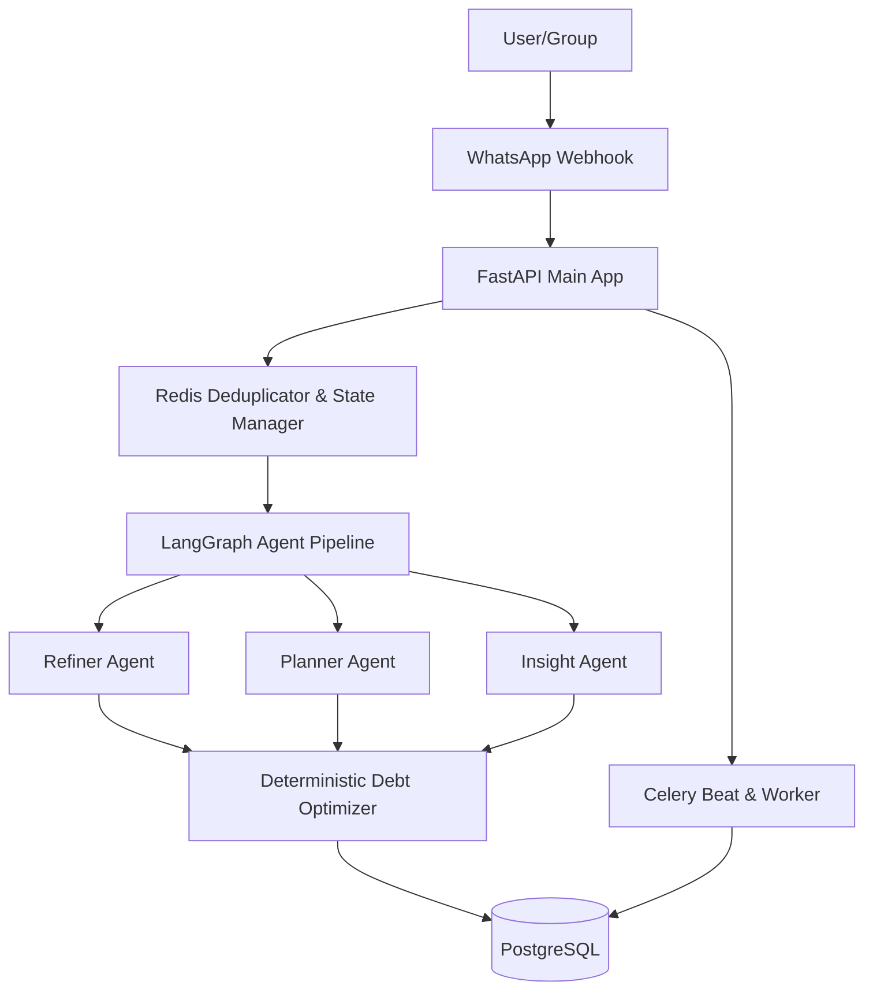
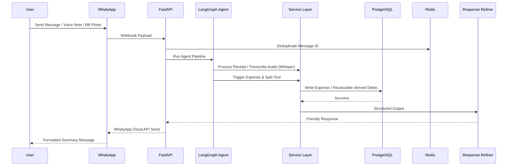

<div align="center">

# 🪙 KharchaSaathi

### Production-Grade Agentic AI WhatsApp Group Expense Settler

<p align="center">
Manage and settle your group expenses directly from WhatsApp using Agentic AI Planning, Natural Language, OCR, and Voice Notes.
</p>

<p align="center">

[](https://kharchasaathi.onrender.com)


</p>

### 🔗 Live Production API URL
`https://kharchasaathi.onrender.com`

---

### 📱 Settle Group Bills on WhatsApp. Skip the Bill-Splitting Apps.

No more downloading third-party splitwise-like apps, creating accounts, or manually adding friends.

KharchaSaathi turns WhatsApp into an **Agentic AI Expense-Settling Assistant** capable of understanding natural language, tracking multi-person group budgets, processing receipt images via OCR, and resolving debts with deterministic mathematical optimization.

</div>

---

# 🌟 Why KharchaSaathi Agentic AI?

Traditional group expense tracking is tedious and prone to friction. Friends often forget to enter bills or get confused by complex split calculations.

KharchaSaathi removes this friction using **Agentic AI LangGraph Reasoning**. Any member of the group simply messages the WhatsApp bot:

```text
Rahul paid 1200 for movie tickets, split equally between Rahul, Alice, and Bob

Maine 500 kharch kiya dinner pe, add my share and Rahul's share

Show current group balances

Optimize debts and show settlement report
```

KharchaSaathi parses the conversational text, extracts names, currencies, and split weights, validates inputs, stores them in PostgreSQL, and outputs beautifully formatted cards directly back to the group.

---

# ✨ Core Features

## 💬 Natural Language Expense Parsing
- Deciphers conversational Hindi, English, and Hinglish split commands seamlessly.
- Handles default splits, equal division, or specific weights per participant.

## 📒 Derived Debt Cache & Event Hooking
- Maintains a dedicated, derived `DEBTS` table that automatically updates after every expense write.
- Prevents database state drifts through robust event-driven triggers.

## 🤖 LangGraph-Powered Agent Pipeline
- Utilizes structured LLM planners to reason through multi-step commands.
- Features custom classification, disambiguation, and user refinement steps.

## 📸 Multimodal OCR Receipt Scanning
- Analyzes food bills, cab receipts, or ticket images using Vision LLMs to extract itemized splits.

## 🎤 Voice Note Transcriptions (Whisper)
- Transcribes incoming audio voice notes via Groq Whisper (`whisper-large-v3`) and routes the transcribed text directly to the agent planner.

## ⚖ Deterministic Debt Optimization (Greedy Max-Flow)
- Employs a strictly **deterministic** mathematical engine to minimize the total number of transactions required to settle up the group.
- **Zero LLM dependency** for core mathematical debt reduction.

## ⏳ Celery Beat Scheduler
- Automatically aggregates overdue debts, monitors group inactivity, and sends daily/weekly outstanding reports.

---

# 🏗 High Level Architecture



---

# 🏛 Production Architecture



---

# 🧩 Agentic Request Lifecycle



---

# ⚙ Tech Stack

- **Backend**: Python 3.12, FastAPI, SQLAlchemy, Alembic, Celery
- **AI Providers**: LangGraph via OpenRouter/Groq, Groq Whisper (Voice to Text), Vision LLMs (Receipt Processing)
- **Database & Cache**: PostgreSQL 16 (Permanent State), Redis (Deduplication, Lock, Queue)
- **Deployment**: Docker, Docker Compose, Render Cloud Platform

---

# 📂 Project Structure

```text
KharchaSaathi
├── app
│   ├── agents          # LangGraph agents (Refiner, Planner, Insights)
│   ├── algorithms      # Pure deterministic debt optimizer math
│   ├── api             # FastAPI Webhook & REST Endpoints
│   ├── core            # Settings, Logging & Database Config
│   ├── db              # SQLAlchemy Models & Migrations
│   ├── memory          # Redis Locks, State Cache & Deduplication
│   ├── services        # WhatsApp Cloud API, Whisper, Vision LLMs
│   └── tools           # Expense tracking, reports, settlements
├── alembic             # Database Migrations
├── scheduler           # Celery beat & worker tasks
├── tests               # Automated Pytest Suite
├── Dockerfile          # Container Deployment Config
├── docker-compose.yml  # Local Development Environment
├── render.yaml         # Render Blueprint Specification
└── README.md
```

---

# 💾 PostgreSQL & Redis Storage Split

| Storage Layer | Data Stored | TTL |
|---------------|-------------|-----|
| **PostgreSQL** | Users, Groups, Group Members, Expenses, Splits, Settlements, derived Debts, Reminders | Permanent |
| **Redis** | Temporary State, Message Deduplication IDs, Celery Task Metadata, Locks | 5 min - 24 hr |

---

# 🚀 Quick Start (Local Development)

```bash
# 1. Clone Repository
git clone https://github.com/your-username/KharchaSaathi.git
cd KharchaSaathi

# 2. Setup Environment Variables
cp .env.example .env
# Edit .env with your token values

# 3. Start Local Environment
docker-compose up -d --build

# 4. Run database migrations
docker-compose exec web alembic upgrade head

# 5. Run tests
.venv/Scripts/python -m pytest
```

---

# 📄 License

This project is licensed under the **MIT License**.
