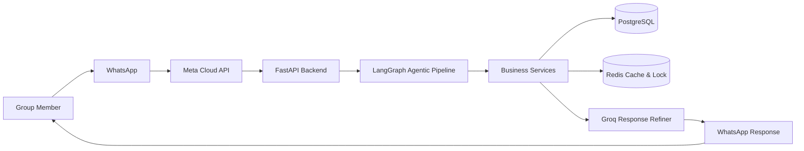
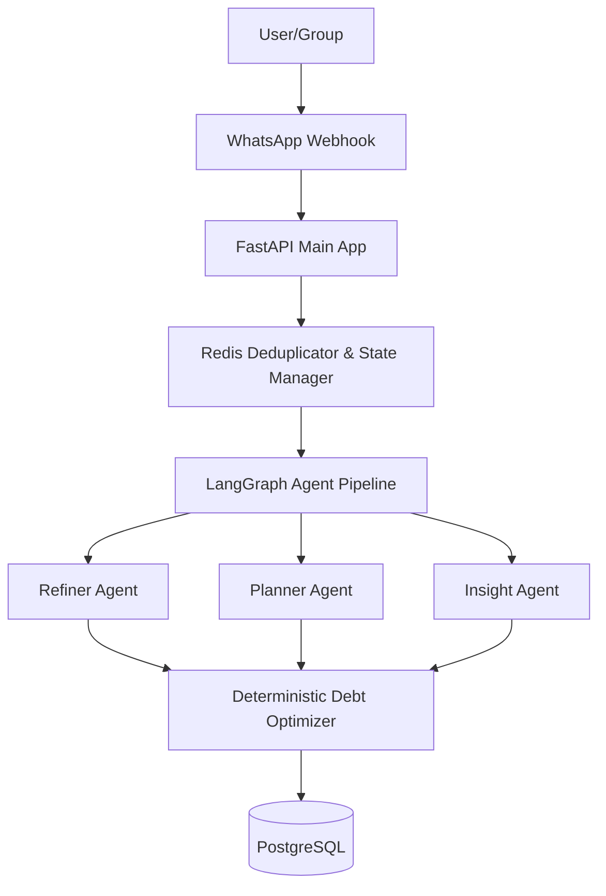
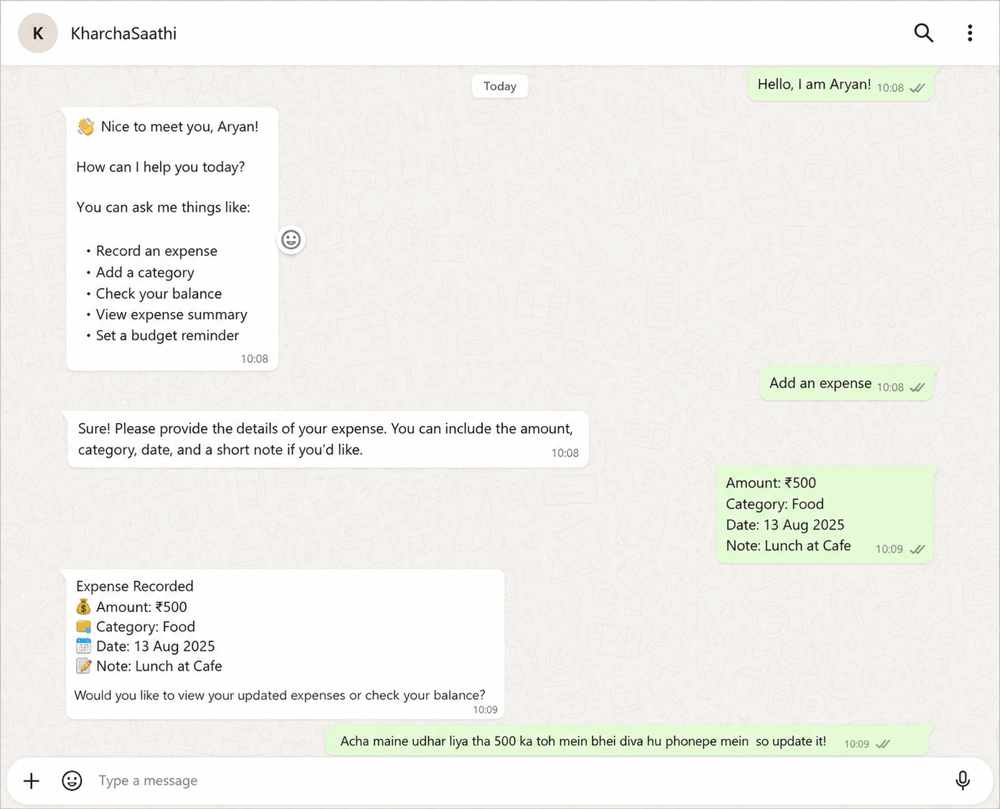
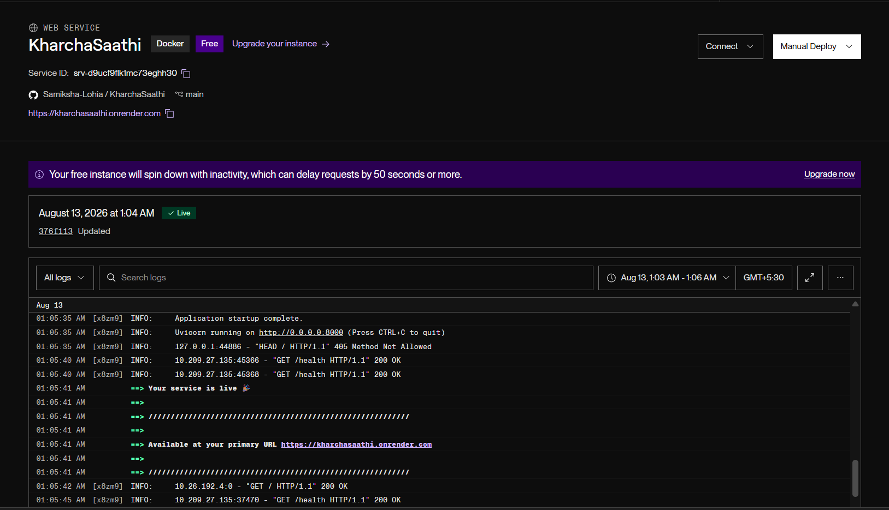

<div align="center">

# 🪙 KharchaSaathi

### WhatsApp Group Expense Settler

<p align="center">
Manage and settle your group expenses directly from WhatsApp using Agentic AI Planning, Natural Language and OCR.
</p>

<p align="center">

[](https://kharchasaathi.onrender.com)


</p>

### 🔗 Live Production API URL
`https://kharchasaathi.onrender.com`

---

### 📱 Settle Group Bills on WhatsApp. Skip the Bill-Splitting Apps.

No more downloading third-party splitwise-like apps, creating accounts, or manually adding friends.

KharchaSaathi turns WhatsApp into an **AI Expense-Settling Assistant** capable of understanding natural language, tracking multi-person group budgets, processing receipt images via OCR, and resolving debts with deterministic mathematical optimization.

</div>

## 🌟 Why KharchaSaathi?

Managing shared expenses shouldn't mean endless calculations, forgotten bills, or confusion over who owes whom.

KharchaSaathi makes group expense tracking easier through WhatsApp. Members can describe expenses in everyday language, check group balances, and get optimized settlement suggestions without manually calculating every split.

```text
Rahul paid 1200 for movie tickets, split equally between Rahul, Anjali, and Tina

Maine 500 kharch kiya dinner pe, add my share and Rahul's share

Show current group balances

Optimize debts and show settlement report
```

KharchaSaathi interprets expense messages, identifies participants and split details, validates the information, and records expenses in PostgreSQL. It then returns clear expense summaries and settlement information directly through WhatsApp.

# ✨ Core Features

## 💬 Natural Language Expense Parsing
- Deciphers conversational Hindi, English, and Hinglish split commands seamlessly.
- Handles default splits, equal division, or specific weights per participant.

## 🤖 LangGraph-Powered Agent Pipeline
- Utilizes structured LLM planners to reason through multi-step commands.
- Features custom classification, disambiguation, and user refinement steps.

## 📸 Multimodal OCR Receipt Scanning
- Analyzes food bills, cab receipts, or ticket images using Vision LLMs to extract itemized splits.

## ⚖ Deterministic Debt Optimization (Greedy Max-Flow)
- Employs a strictly **deterministic** mathematical engine to minimize the total number of transactions required to settle up the group.
- **Zero LLM dependency** for core mathematical debt reduction.
- Automatically aggregates overdue debts, monitors group inactivity, and sends daily/weekly outstanding reports.

---

# 🏗 High Level Architecture



---

# 🏛 Production Architecture



---
# 📸 Screenshots & Live Deployment

## 1. WhatsApp Conversation Assistant


---

## 2. Live Render Cloud Production Deployment


---

# ⚙ Tech Stack

- **Backend**: Python, FastAPI, SQLAlchemy
- **AI Providers**: LangGraph via OpenRouter/Groq, Vision LLMs (Receipt Processing)
- **Database & Cache**: PostgreSQL, Redis

---

# 📂 Project Structure

```text
KharchaSaathi
├── app
│   ├── agents          # LangGraph agents (Refiner, Planner, Insights)
│   ├── algorithms      # Pure deterministic debt optimizer math
│   ├── api             # FastAPI Webhook & REST Endpoints
│   ├── core            # Settings, Logging & Database Config
│   ├── db              # SQLAlchemy Models & Migrations
│   ├── memory          # Redis
│   ├── services        # WhatsApp Cloud API, Vision LLMs
│   └── tools           # Expense tracking, reports, settlements
├── scheduler           # Worker tasks
├── tests               # Automated Pytest Suite
├── render.yaml         # Render Blueprint Specification
└── README.md
```

---
